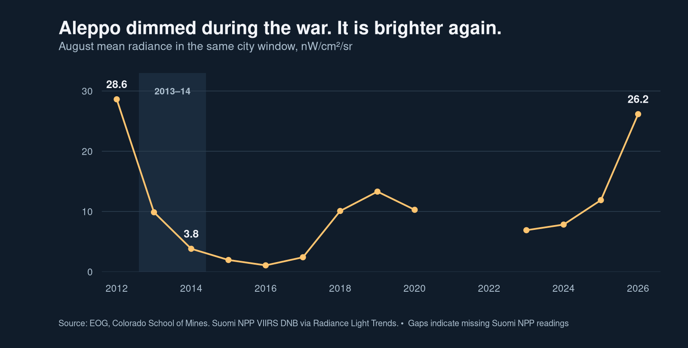
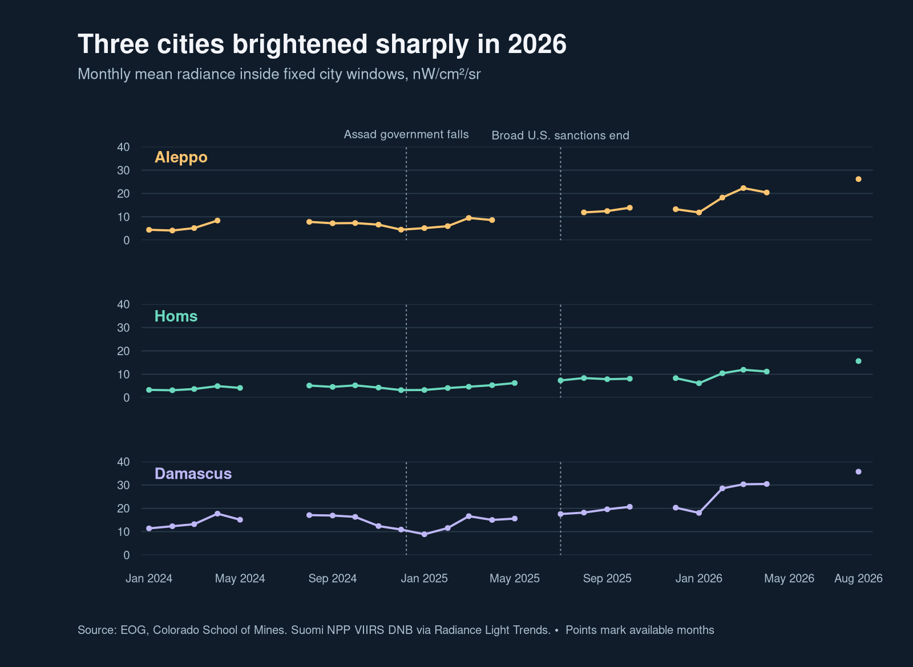
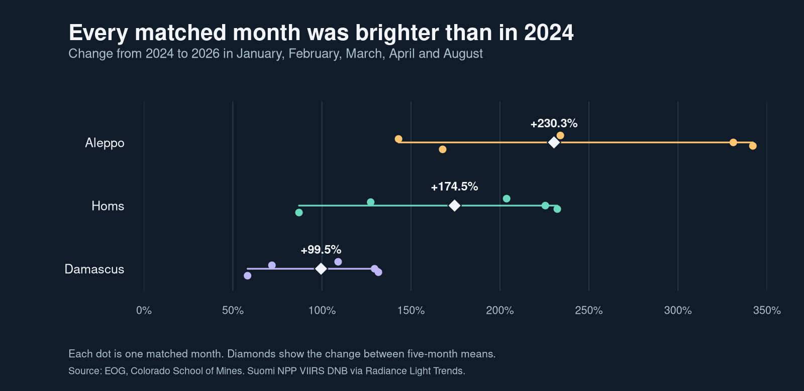

# Syria is starting to glow once more

*What satellite night lights can tell us about electricity and recovery in Aleppo, Homs, and Damascus.*

**Hekmat Matthew Aboukhater** · November 11, 2026

I grew up in Aleppo. In 2013 and 2014, some of the worst years I spent there, I remember going days at a time without electricity. When a power cut lasts an hour, you wait it out. When it lasts days, you have to plan around it. Will there be enough power to pump water into the building? How long will food stay cold? Can you charge your phone before you need it to reach someone?

I remember the outages in days. A satellite records the light that reaches its sensor when it passes overhead. I wanted to see what that record looked like for the city I remember and for the city after the fall of Bashar al-Assad and the easing of sanctions. In five comparable months of 2026, the part of Aleppo I measured was **3.3 times as bright** as in those same months of 2024. Homs and Damascus brightened, too. The numbers tell us where light is returning. The harder question is how that change is reaching households.



The figure follows the same section of Aleppo in August each year. The average radiance fell from 28.6 in August 2012 to 9.9 in August 2013 and 3.8 in August 2014, about an 87 percent decline over two years. The war had already begun in 2012, so that first reading is an early wartime reference. An earlier study found extensive losses of night light across Syria using a different satellite record. My comparison follows a single sensor and a smaller footprint. [Li and Li, *International Journal of Remote Sensing* (2014)](https://doi.org/10.1080/01431161.2014.971469).

## What it meant to have power

Electricity makes other services work. A pump can be intact and still be useless without power. In its 2022 assessment, the United Nations Development Programme described Syrian water networks that could pump for only a few hours a week. Clinics needed backup power for equipment and refrigeration. Businesses that could pay for private generation had options that others lacked, and the costs of backup power reached customers, too. For a household, the difference between a reliable supply and an unpredictable one shows up in what you can keep in the fridge and whether you can get work done after dark. [UNDP, *The Impact of Electricity on Humanitarian Needs in Syria* (2022)](https://www.undp.org/sites/g/files/zskgke326/files/2022-08/Electricity%20Impact%20on%20Humanitarian%20Needs_Syria_ISC-final.pdf).

There were several ways for the electricity system to fail. A power station could be damaged, a transmission line could be severed, or a plant that was still standing could run short of fuel or parts. UNDP reported that Syria’s generation capacity went from 5,800 megawatts in 2010 to 2,000 in 2024, then to between 1,200 and 1,500 at the start of 2025. In June 2025, the World Bank put average grid supply at two to four hours a day. That national figure came more than a decade after the outages I remember. It gives some sense of how long unreliable electricity remained part of ordinary life. [UNDP on generation capacity](https://www.undp.org/syria/press-releases/qatar-provides-reliable-natural-gas-supplies-syria-critical-improving-electricity-supply) · [World Bank on the electricity system](https://www.worldbank.org/en/news/press-release/2025/06/25/syria-world-bank-us-146-million-grant-to-improve-electricity-supply-and-support-sector-development).

## How sanctions changed what Syria could buy and finance

The United States designated Syria a state sponsor of terrorism in 1979. The Syria Accountability Act of 2003 and the executive order that implemented it in 2004 added trade restrictions. The sanctions became much broader after the Assad government’s crackdown in 2011. An August executive order blocked Syrian government property under U.S. jurisdiction, barred new investment and most services by U.S. persons, and imposed restrictions on dealings in Syrian petroleum. European measures added a separate set of restrictions on trade and finance. [U.S. State Department sanctions chronology](https://2021-2025.state.gov/syria-sanctions/) · [Council of the EU sanctions history](https://www.consilium.europa.eu/en/policies/syria/).

The Caesar Act, signed in December 2019 and first used for designations in June 2020, increased the risk for firms outside the United States. Foreign firms could face U.S. sanctions for certain significant transactions with the Syrian government, including some construction and engineering services and support for oil and gas production. Washington’s stated aim was to put pressure on the Assad government and the networks that financed it. For electricity, the relevant question is who would sell equipment, finance a contract, or handle a transfer when a Syrian public entity was on the other end. A repair can require a willing supplier and a bank willing to clear the payment before any equipment moves. [Caesar Act, Title LXXIV](https://www.govinfo.gov/app/details/PLAW-116publ92) · [U.S. Treasury’s first designations](https://home.treasury.gov/news/press-releases/sm1037) · [Carter Center review](https://www.cartercenter.org/wp-content/uploads/2020/09/us-and-european-sanctions-on-syria-091620.pdf).

The rules had humanitarian exceptions. After the February 2023 earthquake, the U.S. Treasury also issued a temporary general license for transactions related to earthquake relief. A UN country assessment documented a gap between what the rules allowed and what banks and other firms were willing to do. Compliance checks, delays, and refusals could still get in the way of transactions permitted on paper. The same distinction matters when restrictions are lifted. A new rule can change in a day. Banking relationships, supply contracts, and damaged power lines take longer to restore. [OFAC General License 23 notice](https://ofac.treasury.gov/recent-actions/20230209_33) · [UN Syria Common Country Analysis](https://syria.un.org/sites/default/files/remote-resources/ca7f1e4849e238a54e3fb37ed5bc9cca.pdf).

## Relief came in stages

Assad’s government fell on December 8, 2024. In February 2025 the EU suspended several restrictions in energy, transport, and finance. In May it lifted its broad economic sanctions while retaining security-related restrictions and measures against people and entities linked to the former regime. The U.S. issued General License 25 and a Caesar Act waiver in May. On July 1, the broad U.S. Syria sanctions program ended under Executive Order 14312. Congress repealed the Caesar Act in December 2025, and the State Department rescinded Syria’s state sponsor of terrorism designation in August 2026. Targeted measures against Assad and others remain. Most of the 2026 satellite readings in this post predate the August 2026 decision. [EU policy timeline](https://www.consilium.europa.eu/en/policies/syria/) · [U.S. Treasury on the 2025–26 changes](https://ofac.treasury.gov/faqs/1220) · [Current U.S. targeted sanctions](https://ofac.treasury.gov/sanctions-programs-and-country-information/paarss).

Fuel and repairs moved on their own timelines. A Qatari gas initiative announced in March 2025 supported generation at Deir Ali. In June the World Bank approved a $146 million grant to repair transmission lines and substations. In February 2026, UNDP announced a separate $10.7 million agreement with Italy and Norway for maintenance and spare parts at Deir Ali. An agreement is a record of money committed and work planned. Meter readings and outage logs would tell us when the work reached households. [UNDP on the gas initiative](https://www.undp.org/syria/press-releases/qatar-provides-reliable-natural-gas-supplies-syria-critical-improving-electricity-supply) · [World Bank electricity grant](https://www.worldbank.org/en/news/press-release/2025/06/25/syria-world-bank-us-146-million-grant-to-improve-electricity-supply-and-support-sector-development) · [UNDP on the 2026 Deir Ali agreement](https://www.undp.org/syria/press-releases/undp-signs-us107-million-agreement-italy-and-norway-boost-electricity-supply-syria).

## What the satellite picked up

I used monthly readings from the VIIRS Day/Night Band on the Suomi NPP satellite. For each of the three cities, I drew a roughly 10-by-10-kilometer window around the urban center and used that same window for every observation. The outcome is the mean radiance of the selected pixels, in nanowatts per square centimeter per steradian. I kept the same instrument throughout and left blank months blank. The [data notes](data/README.md) include the boundaries, archive dates, and coverage rules. [Earth Observation Group dataset](https://eogdata.mines.edu/products/vnl/) · [Radiance Light Trends](https://doi.org/10.5880/GFZ.1.4.2019.001) · [Elvidge et al. on VIIRS night lights](https://doi.org/10.1080/01431161.2017.1342050).



August was the last month in the export. Only **January, February, March, April, and August** had usable readings in all nine city-year combinations across 2024–26. I averaged those five months for each city and year so that a difference in the mix of seasons would not drive the comparison. The 2024 reference months all come before the December transition. Four of the five 2025 reference months also come before the major May–July relief, which matters when reading the middle column.

| City window | 2024 mean | 2025 mean | 2026 mean | Change from 2024 to 2026 |
| --- | ---: | ---: | ---: | ---: |
| Aleppo | 5.99 | 8.23 | 19.80 | +230.3% |
| Homs | 4.03 | 5.12 | 11.05 | +174.5% |
| Damascus | 14.33 | 14.04 | 28.59 | +99.5% |

*Mean radiance in nW/cm²/sr. Each value averages five observed monthly composites. Percentages use unrounded means. [Results CSV](data/matched-means.csv).*

Aleppo had the largest relative gain in the three windows. Damascus had the largest increase in absolute radiance, 14.26 units compared with 13.80 in Aleppo. The change is visible even if I leave out August. Across January through April alone, the 2026 increase over 2024 was 229 percent in Aleppo, 164 percent in Homs, and 96 percent in Damascus. Looking separately at August–October, the first three shared months after the July 2025 U.S. change, all three windows were already brighter than in August–October 2024. That comparison puts Aleppo up 71 percent, Homs up 63 percent, and Damascus up 16 percent. [Comparison checks](data/comparison-checks.csv).



The calculation in R is short once the missing observations have been dealt with. The full script reads the raw exports, keeps the Suomi NPP layers, and verifies the common months before making the table.

```r
means <- aggregate(radiance ~ city + year, matched, mean)
baseline <- subset(means, year == 2024, select = c(city, radiance))
names(baseline)[2] <- "radiance_2024"
comparison <- merge(subset(means, year == 2026), baseline, by = "city")
comparison$pct_change <- 100 * (comparison$radiance / comparison$radiance_2024 - 1)
```

## What would tell us more

A satellite can pick up a street lamp, a business running a generator, or a neighborhood where more people have come back. Each could increase radiance at the satellite’s overpass time. Power that comes on during the day, or goes mainly to indoor uses, may barely register. Even in Aleppo, UNDP documented serious electricity and water disruptions in two neighborhoods in January 2026 following renewed fighting. The average across my Aleppo window and those local reports describe different levels of the same recovery. [UNDP’s January 2026 Aleppo assessment](https://www.undp.org/syria/publications/flash-update-urgent-basic-services-needs-and-early-recovery-priorities-sheikh-maqsoud-and-ashrafieh-aleppo).

These are three urban windows exposed to the same national policy changes. Each also went through political transition, population movement, and changes in the electricity supply. The timing leaves the effect of sanctions relief unidentified. To study the repair mechanism, I would start with dated utility records for when distribution circuits were put back into service. If the rollout dates and service areas were available, I could compare changes in supply hours and radiance around each repair with similar circuits still waiting, check their earlier trends, and look for spillovers across the grid. To study the role of sanctions relief, I would also want dated records of payments, imports, and repair contracts. Those would help trace when a change in the rules made a particular project feasible.

August 2026 was the brightest observed August in the Aleppo window after 2012. What I most want to know is how much of that light comes from people being able to count on the power again. I remember measuring a cut in days. I would like to be able to measure the change in the hours that families get back.

### Reproduce the analysis

Run `Rscript analysis.R` from the repository root. The script uses base R with Cairo PNG support and rebuilds the tables and three figures from the archived CSVs. [R script](analysis.R) · [Data and methods](data/README.md) · [Monthly series](data/monthly-npp.csv).
